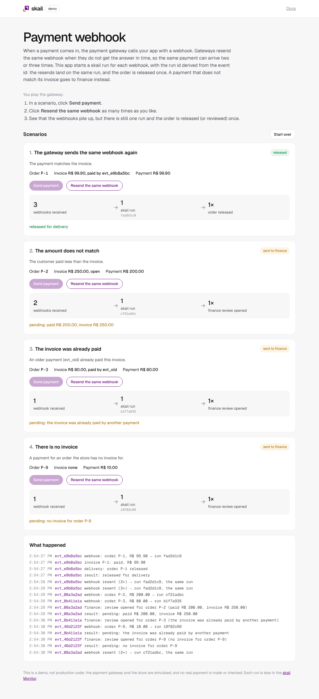

# skail payment webhook (Node.js)

[Português (Brasil)](README.pt-BR.md)

An app with a skail function that releases an order when the payment gateway says the payment came in. Gateways send the same webhook two or three times, so the run id is derived from the event id: the resends land on the same run, and the order is released once. When the payment does not match the invoice, finance gets a review and the order stays put. You play the payment gateway on a page the app serves at http://localhost:8080.

It shows three skail features:

- a **run id derived from the business id**: a UUID v5 of the event id, so a resent webhook does not start a second run;
- **idempotent commands**: every write uses the event id as its key, so a retried command does not do it twice;
- **results instead of errors**: a payment that does not match comes back as a result and goes to finance, because another attempt would not change it.

## Requirements

- One of: [Docker](https://docs.docker.com/get-docker/), [Podman](https://podman.io/docs/installation) or [Node.js](https://nodejs.org) 20.12 or newer. The run script uses the first one it finds.
- A skail environment with a workload registered for the `SKAIL_WORKLOAD` in `.env` (`demopaymentwebhook:v1.0.0` by default). The [Quickstart](https://docs.skail.dev/comece-aqui/quickstart) shows how to create the account, the environment and the workload.

The project uses `@skail/runtime` and `@skail/build` **2.0.1-rc4**.

## Run

```bash
cp .env.example .env     # fill in SKAIL_SIDECAR, SKAIL_NAMESPACE and SKAIL_KEY (portal > Environments & keys > Connect)
scripts/run.sh           # then open http://localhost:8080
```

On Windows, in PowerShell: `copy .env.example .env`, then `powershell -ExecutionPolicy Bypass -File scripts\run.ps1`. The script works on the Windows PowerShell built into Windows; PowerShell 7 is not needed.

The script runs the demo with what the machine has: Docker, then Podman, then Node.js. If it finds none of them, it says what to install. Without the script, the commands are `npm install`, `npm run build` and `npm start`.



You play the payment gateway. The page has one card per scenario: click **Send payment** to send its webhook, with a new event id, then **Resend the same webhook** as many times as you like, like a gateway that did not get the answer in time. Each card counts the webhooks received, shows the one skail run they all land on, and how many times the order was released or a finance review was opened: once, however many webhooks arrive. **Start over** brings the invoices back to the start. Each step also shows up under **What happened** and in the console, and the page refreshes itself every second.

## The scenarios

The demo store has three invoices: **P-1** R$ 99.90 (open), **P-2** R$ 250.00 (open) and **P-3** R$ 80.00 (already paid by an older event).

| Scenario | Payment | What happens | Result |
|---|---|---|---|
| **1. The gateway sends the same webhook again** | P-1, R$ 99.90 | the invoice is paid and the order is released once, however many times the webhook is resent | `released for delivery` |
| **2. The amount does not match** | P-2, R$ 200.00 | the amount does not match the invoice; finance gets a review | `pending: paid R$ 200.00, invoice R$ 250.00` |
| **3. The invoice was already paid** | P-3, R$ 80.00 | the invoice was already paid by another payment | `pending: the invoice was already paid by another payment` |
| **4. There is no invoice** | P-9, R$ 10.00 | there is no invoice for the order | `pending: no invoice for order P-9` |

## How it works

The app does three jobs in one process: it serves the page, it hosts the worker that runs the function (`createSkailPlatform`, with the bundle built by `npm run build`), and it plays the payment gateway and the webhook endpoint, starting one run per event through the skail HTTP API. The demo store (invoices, deliveries and finance reviews) lives in the same process and reports each change to a timeline the page shows. The commands run in an isolated VM, so they reach the demo store over HTTP, on the app's own port under `/internal/`, as they would reach a real database API.

The run id is a UUID v5 of the event id, with a fixed namespace of the application ([`src/run-ids.ts`](src/run-ids.ts)). The same event always gives the same run id, and skail does not start a second run for an id it already has:

```http
POST {SKAIL_SIDECAR}/api/v1/trigger/demopaymentwebhook/v1.0.0/ReleaseOrder/{UUID v5 of the event id}
[{"eventId": "evt_5533bee0", "orderId": "P-1", "amount": 99.9}]
```

The function, in [`src/payment-functions.ts`](src/payment-functions.ts):

```ts
@SkailFunction()
async ReleaseOrder(payment: PaymentConfirmed): Promise<string> {
  const settlement = await this.SettleInvoice(payment);
  if (!settlement.done) {
    // the money came in, but something does not match: finance reviews it before the order leaves
    await this.OpenFinanceReview(payment, settlement.reason!);
    return this.ReportResult(payment.eventId, PaymentResults.pending(settlement.reason!));
  }

  await this.ReleaseForDelivery(payment.orderId, payment.eventId);
  return this.ReportResult(payment.eventId, PaymentResults.released);
}
```

- `SettleInvoice` checks the invoice and records the payment against it. A mismatch comes back as a result (`done = false`), not an exception.
- `ReleaseForDelivery` only runs with the invoice settled, and `OpenFinanceReview` takes its place on a mismatch.
- Every write uses the event id as its key. If the app stops in the middle of a command, skail runs it again, and the store does not apply it twice.

| File | What it has |
|---|---|
| `src/payment-functions.ts` | The function and its commands. |
| `src/run-ids.ts` | The run id from the event id (UUID v5). |
| `src/simulated-store.ts` | The demo store: invoices, deliveries and finance reviews. |
| `src/payment-desk.ts` | Plays the gateway for the page: sends the payment of each scenario, and resends it. |
| `src/demo-payments.ts` | The payment of each scenario. |
| `src/timeline.ts` | The timeline of the steps, for the console and the page. |
| `page/index.html` | The page, with the skail branding. |
| `src/skail-api.ts` | The trigger through the skail HTTP API. |
| `src/main.ts` | Reads `.env`, serves the page, its API and the demo store, and starts the worker. |
| `scripts/build-skail.mjs` | Builds the bundle into `.skail/` for `SKAIL_WORKLOAD`; run `npm run build` again if it changes. |
| `scripts/run.sh`, `scripts/run.ps1`, `Dockerfile` | Run the demo with Docker, Podman or Node.js, whatever the machine has. |

In the portal, open the [Monitor](https://docs.skail.dev/referencia/portal/monitor) of your environment: there is one `ReleaseOrder` run per event, however many times it was sent. It lists `SettleInvoice`, `ReleaseForDelivery` and `ReportResult`; on a mismatch, `OpenFinanceReview` takes the place of `ReleaseForDelivery`. Every path ends as **Completed**, because a mismatch is a result.

## Notes

- Each **Send payment** uses a new event id, so it does not land on the runs of a previous one. The demo store lives in memory and starts over when the app starts or on **Start over**.
- Apps running the same `SKAIL_WORKLOAD` on the same environment share the same runs: use one workload (or environment) per person.

## Disclaimer

**This is a demo, not production code.** It exists only to show how [skail](https://docs.skail.dev) works and is provided "as is", without warranty of any kind. The payment gateway and the store are simulated: no real payment is made or checked.

## License

[Apache-2.0](LICENSE)
