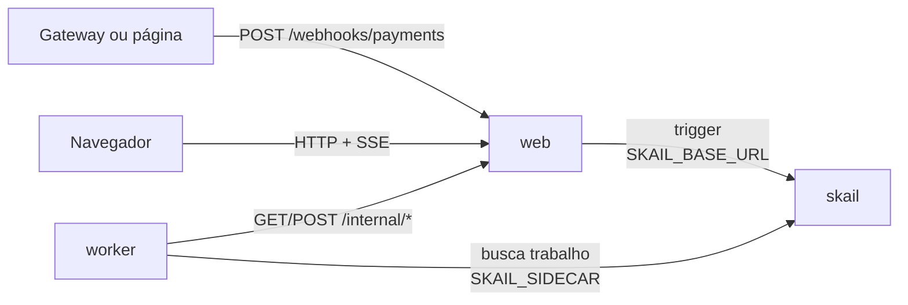

# skail payment webhook (Node / TypeScript + React)

[English](README.md)

O gateway de pagamento avisa que um pagamento caiu, às vezes duas ou três vezes para o mesmo pagamento. O web recebe o webhook e inicia uma function do skail com um id derivado do id do evento, então os reenvios caem na mesma execução e o pedido é liberado uma vez só. O pedido só sai quando a fatura bate; valor diferente, fatura inexistente ou fatura já paga por outro pagamento vão para revisão do financeiro, e o pedido fica parado. Uma página React faz o papel do gateway e mostra cada passo assim que ele acontece.

A demo mostra três tópicos da [documentação do skail](https://docs.skail.dev):

- o [id do trigger](https://docs.skail.dev/referencia/api-http/post-trigger) derivado do id de negócio com UUID v5, para um reenvio não iniciar uma segunda execução;
- [commands idempotentes](https://docs.skail.dev/construa/como-fazer/escrever-commands-idempotentes): cada gravação nas faturas e nas entregas usa o id do evento como chave;
- [tratar erros](https://docs.skail.dev/construa/como-fazer/tratar-erros-e-desfazer-passos): uma divergência volta como resultado e vai para o financeiro, e um serviço que continua fora do ar lança exceção.

## Como funciona



- **worker** (`apps/worker`): a function `ReleaseOrder(payment)` e os commands dela. O `SettleInvoice` confere a fatura e dá baixa com o pagamento; o `ReleaseForDelivery` libera o pedido; o `OpenFinanceReview` manda uma divergência para o financeiro; o `ReportStatus` avisa a página do andamento da execução.
- **web** (`apps/web`): o endpoint do webhook, a API da página e os dados da demo (faturas, entregas e revisões do financeiro), em memória. Inicia a execução (trigger) e transmite o estado para a página (SSE).
- **frontend** (`apps/frontend`): a página, em React 18, Vite e TypeScript. Tem os botões do gateway e as tabelas em tempo real.
- **contracts** (`apps/contracts`): tipos, constantes e funções puras usados pelos outros três. Ele também entra no bundle do skail, por isso não importa módulos de I/O do Node.

No seu sistema, as faturas e as entregas estariam no seu banco. Aqui elas ficam no web, e o worker acessa por HTTP.

O endpoint transforma o id do evento no id da execução com UUID v5 e um namespace fixo da aplicação. O mesmo evento gera sempre o mesmo id, e o skail não inicia uma segunda execução para um id que já tem ([`app.ts`](apps/web/src/app.ts)):

```ts
const taskId = executionIdFromEventId(payment.eventId); // same event => same execution id
await gateway.trigger(taskId, payment);
// If skail did not accept it, answer with an error: the gateway resends later and the resend lands on the same execution.
```

A function só orquestra e deixa o I/O para os commands. O trecho abaixo é uma versão simplificada do [`payment-functions.ts`](apps/worker/src/payment-functions.ts), que também avisa a página de cada etapa:

```ts
const settlement = await this.SettleInvoice(payment);
if (!settlement.done) {
  // The money came in, but something does not match: finance reviews it before the order leaves.
  await this.OpenFinanceReview(payment, settlement.reason!);
  result = PaymentResults.pending(settlement.reason!);
} else {
  await this.ReleaseForDelivery(payment.orderId, payment.eventId); // only runs with the invoice settled
  result = PaymentResults.released;
}
```

Uma divergência é resultado, não erro, porque outra tentativa não mudaria nada. Um web que não responde lança exceção, e o skail roda o command de novo (`retryCount: 3`). Se todas as tentativas falharem, a function avisa `Failed` para a página e relança a exceção, e a execução aparece como falha no Monitor.

## Os caminhos

A página tem um botão por caminho. Cada botão manda um evento novo para o webhook; o **Send again** reenvia o último com o mesmo id de evento. As faturas iniciais são **P-1** R$ 99,90 (aberta), **P-2** R$ 250,00 (aberta) e **P-3** R$ 80,00 (já paga por `evt_old`).

| Botão | O que acontece | Resultado |
|---|---|---|
| **P-1 · R$ 99.90** | a fatura recebe a baixa e o pedido é liberado uma vez | `released for delivery` |
| **Send again** | o mesmo evento cai na mesma execução; o P-1 continua liberado uma vez | (mesma execução) |
| **P-2 · R$ 200.00** | o valor não bate com a fatura; o financeiro recebe uma revisão | `pending: paid R$ 200.00, invoice R$ 250.00` |
| **P-3 · R$ 80.00** | a fatura já foi paga por outro pagamento | `pending: the invoice was already paid by another payment` |
| **P-9 · R$ 10.00** | não existe fatura para o pedido | `pending: no invoice for order P-9` |

O **Reset demo** reabre as faturas e limpa os eventos e as revisões.

A página chama o endpoint do webhook, que você também pode chamar pelo terminal:

```bash
curl -X POST localhost:8080/webhooks/payments -H 'Content-Type: application/json' \
  -d '{"eventId":"evt_1","orderId":"P-1","amount":99.9}'
```

Rode duas vezes: as duas chamadas respondem o mesmo `taskId`, e o P-1 é liberado uma vez só. Se o skail não aceitar o trigger, o webhook responde `502` e o evento aparece como **Not accepted**; o gateway reenvia depois, e o reenvio cai na mesma execução.

## Como conecta ao skail

| Serviço | Variável | Para quê |
|---|---|---|
| worker | `SKAIL_SIDECAR` | Conecta a function ao seu environment e recebe o trabalho dela. |
| web | `SKAIL_BASE_URL` | Inicia execuções pela API HTTP do skail. |

Os dois usam os mesmos `SKAIL_WORKLOAD`, `SKAIL_NAMESPACE` e `SKAIL_KEY`. O web faz uma chamada por entrega do webhook:

```http
POST {SKAIL_BASE_URL}/api/v1/trigger/{nome}/{versao}/ReleaseOrder/{taskId}
[{"eventId": "evt_1", "orderId": "P-1", "amount": 99.9}]
```

`{nome}` e `{versao}` vêm de `SKAIL_WORKLOAD` (`nome:versao`). Cada chamada manda a chave em `skail-key` e em `Authorization: Bearer`, mais o header `Skail-namespace`, como descrito em [autenticação](https://docs.skail.dev/referencia/api-http/autenticacao). `429`, `5xx` e erros de rede são repetidos com o mesmo task id. `401` e `403` não são repetidos: confira `SKAIL_KEY` e `SKAIL_NAMESPACE`.

O navegador nunca chama o skail. Ele só fala com o web, então a chave fica no servidor.

## Requisitos

- Node 20, 22 ou 24 e pnpm 10 (`npm i -g pnpm@10.34.7`)
- podman ou docker
- PowerShell 7+ (`pwsh`), só se você usar o `scripts/run.ps1` em vez do `scripts/run.sh`
- Um environment do skail com o workload de `SKAIL_WORKLOAD` cadastrado (`demopaymentwebhook:v1.0.0` por padrão). O [Quickstart](https://docs.skail.dev/comece-aqui/quickstart) mostra como pedir a conta, criar o environment e cadastrar o workload.
- Acesso ao registro público do npm, de onde vêm `@skail/runtime`, `@skail/testing` (2.0.1-rc1) e `@skail/build` (2.0.0).
- Um navegador atual (Chrome/Edge 111+, Firefox 113+, Safari 16.2+). A página usa Server-Sent Events e `color-mix()` do CSS.

## Configurar

```bash
cp .env.example .env     # o .env guarda a chave e é ignorado pelo git
```

Preencha `SKAIL_WORKLOAD` (exatamente como está cadastrado no portal), `SKAIL_NAMESPACE`, `SKAIL_KEY`, `SKAIL_SIDECAR` e `SKAIL_BASE_URL` com os valores do seu environment.

O bundle do skail não lê variáveis de ambiente, então o worker recebe `SKAIL_WORKLOAD` e `WEB_BASE_URL` no build ([`gen-config.mjs`](apps/worker/scripts/gen-config.mjs)). Depois de mudar esses valores no `.env`, faça o build de novo; o `scripts/run.sh up` já faz isso.

## Rodar com podman ou docker

```bash
scripts/run.sh up        # builda as duas imagens e sobe web + worker
scripts/run.sh logs
scripts/run.sh down
```

`CONTAINER_ENGINE=docker` força o docker. No Windows, ou em qualquer sistema com PowerShell 7+, rode `pwsh scripts/run.ps1 <comando>` com os mesmos comandos; `$env:CONTAINER_ENGINE = "docker"` força o docker.

Abra <http://localhost:8080>. O endpoint do webhook é `http://localhost:8080/webhooks/payments`.

### Ver o reenvio

1. Clique em **P-1 · R$ 99.90**. O evento passa de **Running** para **Released**, e a fatura P-1 mostra `paid by evt_…` e **×1** liberado.
2. Clique em **Send again**, uma ou duas vezes. A coluna **Received** vai para **×2** ou **×3** com o mesmo id de execução, e o P-1 continua com **×1** liberado.

No portal, abra o [Monitor](https://docs.skail.dev/referencia/portal/monitor) do seu environment e procure pelo id da execução. Existe uma execução para o evento, não importa quantas vezes ele foi enviado. Ela lista `ReportStatus`, `SettleInvoice`, `ReleaseForDelivery` e `ReportStatus`, cada um com argumentos e resultado; numa divergência, o `OpenFinanceReview` entra no lugar do `ReleaseForDelivery`. Todo caminho termina como **Completed**, porque uma divergência é resultado; o resultado da function diz como o pagamento terminou.

O `scripts/run.sh kill-worker` mata o worker com SIGKILL, como numa queda, e o `scripts/run.sh start-worker` sobe de novo. Uma execução que estava no meio continua do último command concluído, e o pedido continua liberado uma vez só.

## VS Code

Abra a pasta e aceite as extensões recomendadas.

- `Ctrl+Shift+B` compila, a task *test* roda os testes e as tasks `containers: up/down/logs/kill-worker/start-worker` chamam o `scripts/run.sh`.
- A configuração de debug **Worker + Web** sobe os dois apps lendo o `.env`, e um breakpoint dentro de um command funciona. A task de build dela grava `WEB_BASE_URL=http://localhost:8080` no bundle, porque fora de container o web fica em `localhost`.
- Para a página com hot reload, rode a task `dev: front end (vite)`. Ela repassa `/api` e `/webhooks` para o web na porta 8080.

## Testes

```bash
pnpm install
pnpm test
```

Os testes unitários cobrem os contratos, a regra da fatura (bate, valor diferente, sem fatura, já paga, nova tentativa da mesma baixa), a function em memória com `@skail/testing` (liberação, revisão, nova tentativa de um command e falha), as chamadas HTTP do worker, o `skail build` do worker, o id da execução a partir do id do evento, os dados da demo, as chamadas ao skail (trigger e novas tentativas), a API web com SSE e a página React. Eles não precisam de rede nem do skail.

## Observações

- Os dados da demo ficam em memória, no web. Reiniciar o web perde as faturas pagas e o histórico da página, mas o skail não roda de novo o que já terminou. O **Reset demo** recomeça.
- O id da execução vem do id do evento, então reenviar um evento de uma sessão anterior cai na execução antiga. Por isso a página cria um id de evento novo a cada clique.
- A assinatura que o gateway manda no header não é validada aqui. Em produção, valide antes do trigger.
- Ler a fatura e dar baixa são duas chamadas. O web recusa a segunda quando outro evento chegou antes, e o command transforma isso em revisão. Um banco de verdade faria as duas numa transação.
- Os valores são comparados em centavos (`Math.round(x * 100)`), então `99.9` e `99.90` são o mesmo pagamento. Em produção, dinheiro deve ser centavos inteiros ou um tipo decimal.
- As rotas `/internal/*`, que o worker chama, não têm autenticação. Para uma demo local isso basta; proteja essas rotas antes de usar o padrão em produção.
- Workers com o mesmo `SKAIL_WORKLOAD` no mesmo environment dividem as mesmas execuções: use um workload (ou environment) por pessoa.

## Licença

[Apache-2.0](LICENSE)
